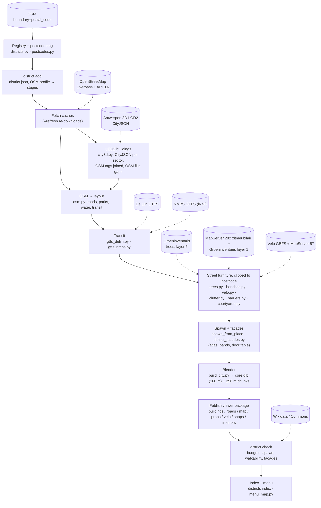

# How the city is built (and how to keep it walkable)

This is the maintainer note for the generated Antwerp tiles. Read it when you need to fix a street you cannot walk, add a landmark, or understand what a district rebuild will overwrite.

The walk viewer is free in the horizontal plane. Nothing paints a navmesh. After each step the player is pushed out of **building rings**, **props** (fences, hedges, trunks, benches), **Velo rails**, **café tables**, **vehicles**, and **deep water** (Scheldt, docks). Shallow ponds are not solids: you wade through them (slower gait, feet on the silt `bed_y`). Streets, parks and squares stay walkable only if those solids leave a gap. That contract lives in code (`cityview/walkability.py`) and is checked at the end of every district build.

## What you edit vs what a rebuild overwrites

A rebuild (`python3 -m cityview district build <id>`) rewrites the viewer package. Do not hand-edit those files and expect the change to last.

| Keep (source) | Overwritten (export) |
|---|---|
| `cityview/districts.py` `DISTRICT_REGISTRY` — postcode, spawn, menu name, facade styles | `districts/<id>/district.json` `spawn` / `boundary` (re-synced from the registry on every build; `origin` is kept) |
| `districts/<id>/cache/*.json` — OSM, trees, benches, Velo, GTFS, CityJSON sectors | `output/<id>/` — layout JSON, Blender job, `.blend`, `core.glb`, `chunks/` (one folder per district, so parallel builds never share files) |
| `assets/boundaries/antwerp_postcodes.geojson`, `antwerp_water.json` | `viewer/districts/<id>/buildings.json`, `roads.json`, `map.json`, `props.json`, `velo.json`, `shops.json`, `interiors.json`, `water.json` |
| `districts/<id>/landmarks/manifest.json` | `viewer/districts/<id>/core.glb`, `chunks/*.glb`, `chunks.json`, `landmarks.json`, streamed `landmarks/*.glb` |
| `districts/<id>/facades/elevations/` | `districts/<id>/facades/atlas/` (atlas, bands, `facade_doors.json`) and its copy under the viewer |
| `districts/<id>/vegetation_overrides.json`, `shop_overrides.json` | derived tree / shop placement in the GLB and `shops.json` |
| `districts/<id>/interiors.json` (curated rooms, `by_osm` / `by_name`) | `viewer/districts/<id>/interiors.json` |
| `cityview/*.py`, `blender/*.py`, `viewer/*.js` | `viewer/districts/index.json`, `viewer/menu/*` (postcode map, minimaps) |

Local metres are **east, north** from `district.json` `origin`. The Three.js viewer uses `z = −y`. When a check prints `(73.9, -80.9)`, that is Blender XY, not lat/lon. A viewer yaw `θ` faces `(−sin θ, cos θ)` in Blender XY, so the spawn `yaw` for a heading `(dx, dy)` is `atan2(−dx, dy)`.

## Pipeline

Each district is one Antwerp **postcode** (2000, 2018, 2020, 2060, 2140 share borders and stream into each other; 2030 Port and 2050 Left Bank are standalone, menu-only). Every bbox-fetched layer is clipped to the postcode ring (`layout["boundary_local"]`), so a tree, bench or Velo dock on a border belongs to exactly one district.



GitHub does not follow `click` links inside Mermaid, so the same sources are listed here:

| Step | Source | Code | Cache |
|---|---|---|---|
| Postcode rings | [OSM `boundary=postal_code`](https://wiki.openstreetmap.org/wiki/Tag:boundary%3Dpostal_code) via Overpass | `cityview/postcodes.py` | `assets/boundaries/antwerp_postcodes.geojson` |
| Streets, parks, water, POIs, tracks | [OpenStreetMap](https://www.openstreetmap.org/) via [Overpass](https://overpass-api.de/) / [API 0.6](https://api.openstreetmap.org/api/0.6/map) | `cityview/osm.py`, `places.py` | `districts/<id>/cache/osm.json` |
| LOD2 buildings | [Antwerpen 3D sector index](https://s3-ant1.antwerpen.be/prd-3d/3d.geojson) → `prd-open-data-datatank/3D/json/seccode_<code>.city.json` | `cityview/city3d.py`, `lod2_mesh.py` | `districts/<id>/cache/` (CityJSON per sector) |
| Trams, buses | [De Lijn GTFS](https://opendata-discovery-gtfs-static.api.production.belgianmobility.io) | `cityview/gtfs_delijn.py` | `districts/<id>/cache/` |
| Trains | [NMBS GTFS (iRail)](https://gtfs.irail.be/nmbs/gtfs/latest.zip) | `cityview/gtfs_nmbs.py` | `districts/<id>/cache/` |
| Trees | [Stad Antwerpen Groeninventaris, layer 5](https://geodata.antwerpen.be/arcgissql/rest/services/P_Groeninventaris/Groeninventaris_extern/MapServer/5) + OSM `natural=tree` | `cityview/trees.py` | `districts/<id>/cache/trees.json` |
| Benches | [MapServer 282 zitmeubilair](https://geodata.antwerpen.be/arcgissql/rest/services/P_Portal/portal_publiek4/MapServer/282), [Groeninventaris layer 1](https://geodata.antwerpen.be/arcgissql/rest/services/P_Groeninventaris/Groeninventaris_extern/MapServer/1) + OSM `amenity=bench` | `cityview/benches.py` | `districts/<id>/cache/benches.json` |
| Velo stations | [Velo GBFS](https://gbfs.smartbike.com/antwerp/1.0/gbfs.json), [MapServer 57](https://geodata.antwerpen.be/arcgissql/rest/services/P_Portal/portal_publiek1/MapServer/57) | `cityview/velo.py` | `districts/<id>/cache/velo.json` |
| Clutter, barriers, courtyards | OpenStreetMap (same extract) | `clutter.py`, `barriers.py`, `courtyards.py` | — |
| Facade elevations | Generated per district (no download) | `cityview/district_facades.py` | `districts/<id>/facades/` |
| Landmark references | [Wikidata](https://www.wikidata.org/), [Wikimedia Commons](https://commons.wikimedia.org/) | `place_refs.py` | `districts/<id>/references/` |
| Menu water | OpenStreetMap via Overpass | `cityview/menu_map.py` | `assets/boundaries/antwerp_water.json` |

Antwerp open data is under the [Stad Antwerpen open data licence](https://www.antwerpen.be/info/gratis-open-data-licentie); OSM is ODbL.

Commands:

```bash
python3 -m cityview district add --postcode 2000
python3 -m cityview district build 2018-harmonie --no-render
python3 -m cityview district build 2000-antwerpen --skip-blender   # JSON only, no GLB
python3 -m cityview district check 2018-harmonie --no-sims
python3 -m cityview district review 2000-antwerpen
python3 -m cityview district interiors 2000-antwerpen  # interiors.json on the published shops.json, no Blender
```

`district interiors` keeps every published sign where the full build put it (`district shops` re-plans from OSM alone and moves signs off the baked façades), only appending far enterable places that are missing and sizing rooms from the published `buildings.json`.

`district add` writes `districts/<id>/district.json` and turns on only the stages that exist in the extract (no trains in the historic core, no port props in Harmonie). `district build` re-syncs the registry, plans from the caches, runs Blender unless you pass `--skip-blender`, publishes the viewer package, then runs `district check`. A failed check is a failed build (unless you skipped Blender and the GLB is missing). A full build of a dense district takes 1–2.5 h; builds of different districts can run in parallel because each writes to its own `output/<id>/` (`scripts/build_all_districts.py` runs them side by side and logs timings).

Builds are local only. GitHub Pages publishes the committed `viewer/` and never runs Blender, so a change to pipeline code or a district's sources ships together with its rebuilt `viewer/districts/<id>/`. Publish Meshopt-compresses every core, chunk and landmark GLB, which needs `node` on PATH (`scripts/compress_glb.mjs`). A passing full build stamps `viewer/districts/<id>/build.json` with a hash of every tracked input (`cityview/district_freshness.py`: build code in `cityview/` and `blender/`, `assets/`, `viewer/cars/`, and the district's own sources minus review output). `python -m cityview district stale` lists packages whose stamp no longer matches the tree; the same check fails the PR in CI. Rules for agents: [district-agent.md](district-agent.md#deploy-contract).

After every build of a district that others border, refresh the shared files:

```python
from cityview.district_pipeline import write_districts_index
from cityview.menu_map import write_menu_map
write_districts_index(); write_menu_map()
```

Agent finishing work after a build is in [district-agent.md](district-agent.md): one review task at a time, proofs under `districts/<id>/review/proofs/`.

### Stages, in order

1. **Registry + boundary** (`cityview/districts.py`, `postcodes.py`). The postcode ring, origin and spawn. `ring` is reprojected once into `layout["boundary_local"]`.
2. **OSM → layout** (`cityview/osm.py`). Roads, parks, water, transit tracks, POIs. Water rings are classified in `cityview/water.py` (shallow pond vs deep river/dock; Scheldt by name; `bank` natural vs built). Multipolygon courtyards become `holes`. Tags that are not a wall (`building=roof`, `location=underground`, bandstands) are marked `walker_solid: false`.
3. **LOD2 buildings** (`cityview/city3d.py`). Antwerpen 3D CityJSON per statistical sector, filtered on `POSTCODE`, Lambert 72 → local metres. The footprint is the plan outline of all ground facets (`plan_outline`). LOD2 wins; OSM tags ride along by overlap; OSM footprints are kept only in data gaps inside the postcode ring (`osm_kept_gap`). A sector that fails to download is skipped and its blocks fall back to OSM. Floating parts (canopies, pilotis towers) are not walker-solid.
4. **Transit** (`gtfs_delijn.py`, `gtfs_nmbs.py`). Tram/bus routes and stops; trains where the profile has them.
5. **Street furniture**, all clipped to the postcode ring. Trees: Groeninventaris + OSM, deduped within 1.8 m, snapped off carriageways, Poisson fill only in sparse parks. A specimen shorter than two humans (`MIN_TREE_HEIGHT` 3.4 m) is emitted as a bush mound, not a trunk+crown; tree crowns keep ≥ 2 m walker clearance. Benches: city registers + OSM, deduped within 1.5 m. Velo: GBFS dock rails only — Blender does not bake the bikes; `viewer/velo.js` instances `velo.glb` in each slot. Clutter and barriers from OSM; barriers are sampled every 0.8 m and cut where a gate, footway or square crosses them.
6. **Spawn + facades.** `district.json` `spawn` projected to local metres (`snap_road: false` keeps a plaza/park point as given). Missing district elevations are generated; `pack_district_atlas` writes the atlas, storey bands and `facade_doors.json` (door positions read off that district's own pictures — the hand-read `facade_kit.DOORS` only matches the shared 2018 set).
7. **Blender** (`blender/build_city.py`). LOD2 shells; photo facades on street edges and on walls facing parks/water (`open_edges`) at the measured eave height of that wall (`street_edge_eaves`); pilotis towers get facades from their underside; doorsteps, awnings, sills from the atlas tables. Park grass subtracts overlapping water rings (`water_holes_for_ring`); shallow water is a silt bed plus surface disc, deep water a single opaque disc. Everything within `CORE_R` (160 m) of spawn goes in `core.glb`, the rest into 256 m cells (`district_chunks.py`; rooftop batches carry a `__c_ix_iy` tag so they peel with their building).
8. **Publish.** `export_walker_buildings` writes every solid footprint in the postcode (rings + holes). `export_props_for_viewer` writes trunks, boxes, barrier segments within 450 m of spawn. Roads become `roads.json`, the minimap `map.json`, and `export_water_for_viewer` writes `water.json` (wade / deep rings, `bed_y`, `bank`). Shopfronts within `VIEWER_SHOP_RADIUS_M` (2000 m) of spawn go to `shops.json`; hospitals, clinics and car repair (`FAR_ENTERABLE_KINDS`) are kept anywhere in the postcode, and an `amenity=atm` node within 30 m flags its bank. `cityview/interiors.py` then writes `interiors.json`: one record per shopfront whose kind has a room template (supermarket, grocery, restaurant, bar_coffee, bank, care, garage; churches never), with the room `w × d` from the façade bay and the footprint depth behind it (capped per template), the door offset `doorA` (also stamped on the shop record), staff / customer counts and the seed the viewer generates the room from.
9. **Check.** Package files, size budgets (`budgets.py`: core ≤ 80 MB / 3 M tris, chunk ≤ 13 MB / 900 k tris), spawn not inside a ring, streamed landmark GLBs, unique facade hashes, then **walkability**: no 3 m stretch of street sealed across its width, no public gate or path/fence crossing still on a collider.

### In the viewer

`viewer/chunk-stream.js` loads the core and the cells around the walker. `viewer/neighbour-districts.js` streams the bordering districts' chunks in their own frame (a few cm lower, so the current district wins z-fights on shared border streets); `viewer/removed-buildings.js` hides neighbour buildings the current package replaces; `viewer/far-field.js` draws distant blocks. Because every district only places what lies inside its own postcode, nothing is drawn twice where two packages overlap.

**Shop interiors** (`viewer/interiors/`) read `interiors.json` and join each record to its shopfront by id. Pressing E at an open door plays a short walk-in (door opens, player walks through) behind the loading veil (`interior-loading.js`), then swaps to a pocket room built at the real façade: `interior-gen.js` lays out the room from the record's template, variant, size and seed; `furniture.js` instances the fixtures with their colliders; and `interior-npcs.js` borrows staff (uniforms in the brand fascia colour, wordmark on the chest, the cashier tagged for later dialog) and customers from the people pool. While inside, the outdoor scene is hidden and only light intensities change, so no shaders recompile. The last 3 rooms stay cached with their people; the 4th visit disposes the oldest room and returns its NPCs to the pool. Churches are always locked, closed shops refuse entry, and `?interior=<shop id | template | variant>` walks straight into a match. At night `door-glow.js` lays a warm threshold sliver and pavement spill in front of every open enterable door, one InstancedMesh for the whole district.

The splash art for the boot loader and the interior veil lives in `viewer/menu/splash/`. `manifest.json` maps each room template to its images, with a `generic` pool as the fallback; a shop always shows the same image, picked by its id. The boot loader rotates `loading-antwerp.jpg` together with the generic pool. All splash art is cast-free (no Pieter, Mo or Jacob). To add art, drop a 1024×576 JPG into the folder and list it in the manifest.

## How walking actually works

There is no walkable mask. `viewer/player-motion.js` integrates WASD. Each frame:

1. A downward ray against meshes named `sidewalk`, `road_`, `park_`, `curb`, `ground`, `tram_`, `courtyard_`, `rail_` sets foot height. It never blocks XZ. Water meshes are not in that set.
2. `viewer/outdoors.js` rejects a step that lands inside a `buildings.json` ring, unless that point is in a courtyard `holes` polygon. Slide along the façade, or snap back.
3. `viewer/water.js` samples `water.json` (whitelisted in `json-cache.js` `PACKAGE_FILES`; without it wading and the deep push-back silently switch off): shallow rings slow the gait and put the feet on `bed_y` (soil under the surface — not `Math.max(0, groundAt)`); deep rings (Scheldt, docks) push you back like a soft wall. Blender draws a silt bed plus either an inset natural shoreline or a straight built kerb. The viewer upgrades `water*` materials to a tinted liquid with a fragment-only shimmer in world XZ (never displace vertices: water GLBs are meshopt-quantized, so a local-space ripple becomes metres-high swells) and one shared ripple clock.
   **Park ponds are sunk at load** (`sinkPonds`, on the core, every chunk and every neighbour chunk, before the tile merge). A pond is a `water_*` mesh with the `water_shallow` material, or a legacy `water` disc that sits on `park_` grass. Its surface drops to lawn − 0.38 m (an opaque dark Lambert with a fog-tinted grazing sheen; no GGX, no transmission, no polygon offset). A stone kade (cap 0.24 m wide at lawn + 0.03, face to − 0.20, wet bank to − 0.45, above the GLB skirt) lines every boundary edge. Its wade ring has `bed_y` lawn − 0.70 and takes precedence over `water.json`. `walkSurface` in `index.html` is the one foot-height source on foot: it eases drops over 0.25 m (the kade) at 3.5 m/s and snaps kerbs. `players.js` lets on-foot soles go below 0 (wheels keep the 0 floor), so the body stands on the bed with the water at the shins. A Velo or scooter cannot wade: `rejectIfDeep(pos, before, wheels)` turns shallow water into the same soft wall as deep water. Older bakes still draw grass across the pond, so two depth-only cutters (the pond outline at lawn level and at + 0.035 above the highest courtyard layer) hide whatever is drawn after them. `RENDER_ORDER` in `water.js` fixes that order: pond / bank / roads (0) → lawn cutter (1) → `park_*` + `ground` (2) → courtyard cutter (3) → `courtyard_*` (4). `mergeStaticMeshes` keys batches on `renderOrder` so the order survives merging. Name-based `layerBias` polygon offsets skip ponds. The far-field skirt (box.min − 0.35 m) carries the largest offset (6, above every layer's max of 5): slope-scaled offsets grow at grazing angles, and an unbiased skirt out-draws the Scheldt and ponds from a few hundred metres.
4. `viewer/props-collide.js` pushes the 0.34 m body out of circles, boxes and thick segments from `props.json`.
5. Live solids: Velo rails (`hw` 0.45 m), open café tables (radius 0.48 m), cars / trams / buses.
6. A soft clamp keeps you inside the district box.

So an “invisible wall” is almost always a collider that is bigger than the mesh, or a mesh that should not have been a collider: a fence drawn as posts with a continuous capsule, a gate left sealed, a Velo rail that was 2 m deep, an underground footprint, a `building=roof` canopy, a courtyard whose hole never made it into `buildings.json`.

Policy (what is solid, which gates open, how wide a Velo rail is) is in `cityview/walkability.py`. The viewer copies the same numbers for Velo and terraces. Change the policy once; do not special-case Groenplaats or Harmoniepark in the export.

## Fine-tuning road and park issues

### 1. Name the solid

Walk into the wall. Decide which family it is:

| Feels like | Usually | Where it is decided |
|---|---|---|
| Gap in a park fence you can see through | Gate node or path crossing left sealed | `cityview/barriers.py` (`GATE_CLEAR_M`, `WALK_CUT_KINDS`) |
| Thin post-and-rail fence you cannot step through | Intentional — garden fences stay solid; only gates and paths open | do not “open every post” |
| Long bar on a square | Velo station or a row of café tables | `viewer/velo.js`, `viewer/terraces.js` |
| Lawn that looks open, body stops | Building ring (underground, canopy, bandstand, missing hole) | `walker_solid_from_tags`, `export_walker_buildings` |
| You slide around a house you should enter | Courtyard hole missing from `buildings.json` | rebuild; holes come from OSM multipolygons |
| Tram you cannot cross | Moving vehicle box (~31 × 2.4 m) — expected while it is there | `viewer/index.html` `collideWorld` |

Coordinates printed by `district check` are local XY. Project them with `district.json` `origin`, or stand at spawn and walk.

### 2. Prefer a rule over a one-off

If the OSM is wrong (a hedge drawn through a path, a building tagged `yes` that is a bandstand), fix the extract: edit OpenStreetMap, then rebuild with `--refresh`. If the OSM is right and we still wall you off, change the **policy**:

- Public gate kinds and “should this building be a wall?” → `cityview/walkability.py`
- Where a fence is split → `cityview/barriers.py` (`WALK_CUT_MARGIN` if a path skims a hedge and still seals)
- Kerbs blocking a plaza → `blender/build_city.py` / `cityview/kerbs.py` (pedestrian / footway / path already skip a raised kerb)
- Walk ways missing from `roads.json` → `WALK_WAY_KINDS` in `cityview/streetscape.py`
- Trees in the wrong plaza → `districts/<id>/vegetation_overrides.json` (see [district-agent.md](district-agent.md)), not collision

Add a unit test next to the rule (`cityview/test_walkability.py`, `test_barriers.py`, `test_streetscape.py`). The next rebuild is the proof; do not patch `viewer/districts/<id>/props.json`.

### 3. Confirm with the check

```bash
python3 -m cityview district check 2000-antwerpen --no-sims
```

It loads the **exported** viewer JSON plus `districts/<id>/cache/osm.json`. Failures look like:

```
footway 863858574 sealed for 4 m at (12.0,-3.1) by hedge
2 path/street crossing(s) still sealed by a barrier, e.g. (-142.0,47.9) by fence
```

Private `access=no` gates, underground parking lift-gates, and service ramps into a garage are ignored. After you change the generator, rebuild, then re-run the check. `skip-blender` is enough when only JSON solids changed.

### 4. What “walk every street” does not mean

You should cross every public street, path, park and square from spawn. You should not walk through a closed garden fence, through a house, or down a Vinci parking ramp. The check encodes that split.

## Adding a custom building

Which buildings still need a custom (backlog + agent checklist): [todo.md](todo.md).

Most buildings stay generated: the LOD2 shell (or the OSM ring + height prior in a data gap) + a façade from the district atlas. A **custom** is a hand-built kit mesh on that same ring, streamed as `viewer/districts/<id>/landmarks/<osm-id>.glb`.

Churches can skip a Python builder. Put `massing` on the manifest entry (`neo_gothic_tower_left`, `church_default`, …) and the generic church kit will extrude the footprint. Use `custom` when the silhouette is a specific building (cathedral, Stadhuis, Feestzaal, Albertpark kiosk).

### 1. Identify the OSM object

Use the review catalog (`viewer/districts/<id>/buildings/catalog.html`) or OpenStreetMap. You need the **way or relation id** and a front-door **anchor** `[lat, lon]`. Relation ids stay as the relation id (the layout already built that mass).

### 2. Register it on this district’s manifest

Edit `districts/<id>/landmarks/manifest.json` (not `assets/landmarks/manifest.json` unless you are sharing a kit across tiles). `by_id` wins; names are a fallback.

```json
"22966134": {
  "id": "22966134",
  "name": "Stadhuis",
  "kind": "civic",
  "custom": "stadhuis",
  "anchor": [51.2213, 4.3997],
  "height_m": 24.0,
  "roof_height_m": 8.0,
  "roof_shape": "gabled",
  "source_url": "https://commons.wikimedia.org/wiki/…",
  "attribution": "…"
}
```

`photo` / `crop` are reference only. Custom meshes never get a photo façade. For a free-standing statue or fountain that is not a building way, add a `nodes` entry and a `NODE_BUILDERS` function.

If the dossier should always mention this building, add `expected_custom` in `cityview/special_buildings.py` (the 2000 civic list is there).

### 3. Write the builder

Builders are pure Python, no `bpy`. They take the surveyed ring (and holes) plus the manifest dict and return a `landmark_kit.Mesh` in world metres.

| Kind of landmark | File |
|---|---|
| Neighbourhood houses, kiosks | `cityview/landmark_models.py` |
| Churches / civic shells that share a façade frame | `cityview/landmark_facades.py` |
| Cathedral, Stadhuis, Het Steen, Nationale Bank | `cityview/landmark_civic.py` |
| Grote Markt guild houses | `cityview/landmark_grote_markt.py` |

Register the function on `BUILDERS` (footprint) or `NODE_BUILDERS` (point) and give it a `TRI_BUDGET` entry. Tests in `cityview/test_landmark_models.py` fail if you blow the budget or use a photo material.

Use `landmark_kit`: `extrude_ring`, `Frame` from the `anchor` so the front door stays on the OSM edge if the outline is redrawn, tiling materials (`brick`, `stone_grey`, `slate`, `zinc`, …). Look at `build_albertpark_kiosk` or `build_stadhuis` before inventing a new primitive.

### 4. Rebuild the mesh

A full `district build` will emit the GLB. To refresh one kit without re-peeling the city:

```bash
python3 -c "from cityview.export_landmark_glbs import export_missing_landmark_glbs; export_missing_landmark_glbs('2000-antwerpen', force=True)"
```

`scripts/refresh_landmark_glbs.py` is the older Blender-in-the-blend path for a fixed set of Harmonie kits; new work should go through `export_missing_landmark_glbs` / the district build.

Then:

```bash
python3 -m cityview district review <id>
python3 -m cityview district check <id> --no-sims
```

The minimap pin comes from `landmarks.json` (`custom` or `stream`). Keep landmark URLs district-scoped — a root `viewer/landmarks.json` once dropped Harmonie’s kiosk on Groenplaats.

## Keeping the system

- **One source for draw and collide.** If you add a new prop kind, export a collider from the same record the mesh uses, and teach `walkability.py` about it if it can seal a street.
- **Checks are the memory.** `cityview/test_walkability.py` holds the policy. `district check` holds the tile. If you walk into a new wall, add a failing test or a check case first, then the rule.
- **No district hardcodes in the generator.** Groenplaats and Harmoniepark are tests of the rules, not `if name == "Groenplaats"` branches.
- **OSM is surveyed geometry.** Invented clutter is the exception (park-edge hedges in Blender are visual-only and must not be written to `props.json`).
- **Rebuild to see tile data; reload the viewer to see JS collision.** Velo / terrace / `outdoors.js` hole handling is live. Building rings and fence gaps need a published JSON.

When something feels like “the world forgot a street”, start at `cityview/walkability.py` and `district check`, not at the GLB.